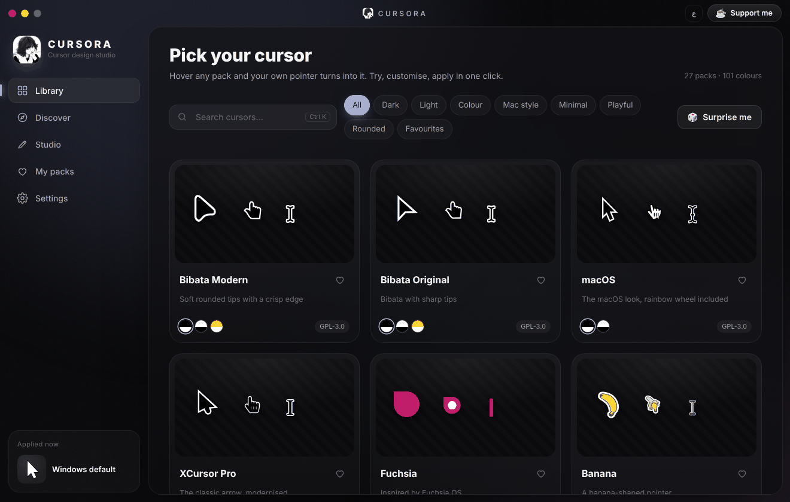
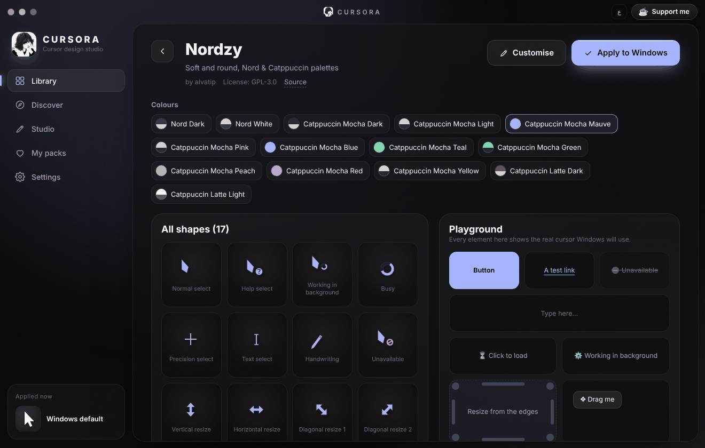
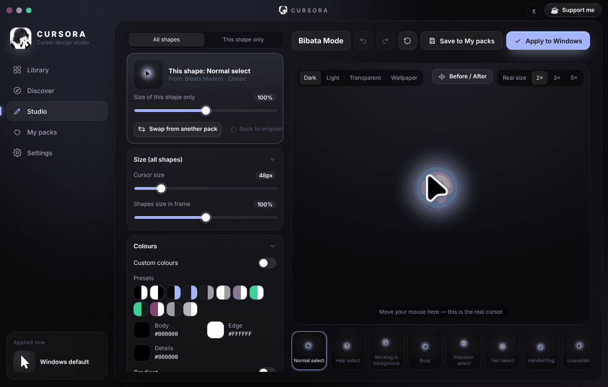

<p align="center">
  
</p>

<h1 align="center">CURSORA</h1>

<p align="center">
  A cursor studio for Windows — browse hundreds of cursor themes, try them with your own pointer,<br>
  customise every detail, and apply them to Windows in one click.
</p>

<p align="center">
  <a href="https://github.com/abogzah559-wq/CURSORA/releases/latest"><b>Download for Windows</b></a>
</p>

<p align="center">
  
</p>

## Features

**Library** — 27 hand-picked open-source cursor packs in 101 colour variants (Bibata, macOS, Fluent, Phinger,
Volantes, Oreo, Nordzy, Nordic, Deepin, Lyra, BreezeX and more). Every pack was compared shape by shape, so there
are no duplicates: packs that share the same design show up once, with their colours as variants. Hover any card and
your pointer turns into that pack.

**Discover** — a curated selection from the [rw-designer](https://www.rw-designer.com/cursor-library) cursor library.
Out of more than 11,000 sets, only complete, modern, high-quality ones make it in: incomplete sets, low-resolution or
jagged pixel art, and look-alikes are filtered out automatically. Sets are downloaded straight from the site, only
when you ask for one.

**Playground** — every one of the 17 Windows cursor roles in its real context: links, text fields, busy buttons,
resize handles, a drag area, a pen pad and more.

<p align="center">
  
</p>

**Studio** — fine-grained control over the whole set or a single shape:

- cursor size, size of each shape on its own, opacity
- body / edge / detail colours, gradients, extra outline
- drop shadow (softness, offset, strength, colour)
- glow — a round halo or one that follows the shape, with colour, brightness, size and softness
- animation speed, left-handed (mirrored) mode
- swap any single shape for the same shape from another pack, picked from a visual grid
- undo / redo, before/after comparison, real-size and zoomed previews on several backgrounds

<p align="center">
  
</p>

**My packs** — save your designs, export/import them as `.cursora` files, or import any cursor folder
(`.cur` / `.ani`, with or without `install.inf`).

**Permanent apply** — cursors are written to `%LOCALAPPDATA%\CursoraCursors` and registered as a regular Windows
cursor scheme. They stay after a restart and even after CURSORA is uninstalled (the uninstaller asks whether to bring
your previous cursor back). After applying, CURSORA measures what Windows actually draws and fixes the size if Windows
did not follow it.

**Updates** — when a new version is out, a small pill appears in the title bar. Click it to download only what
changed, click again to restart into the new version.

Also: Arabic and English interface, accent colours, `Ctrl+Shift+R` to restore the default Windows cursor instantly.

## Install

Download `CURSORA-Setup-x.y.z.exe` from the [latest release](https://github.com/abogzah559-wq/CURSORA/releases/latest)
and run it. Windows 10 and 11 (x64) are supported.

## Building from source

Requirements: Node.js 22+ on Windows.

```bash
npm install
npm start            # run in development
npm run selftest     # render, encode, apply, verify and restore on the current machine
npm run dist         # build the installer into dist/
```

Every push is built and tested on a Windows runner (see `.github/workflows/build.yml`): the self-test renders all
packs, encodes the `.cur`/`.ani` files, applies them through the registry, loads them back with
`LoadCursorFromFile`, measures the drawn sizes and restores the original scheme. Tags `v*` publish a release.

### Project layout

| Path | What |
|---|---|
| `main/` | Electron main process: window, Windows registry integration, updates, Discover downloads |
| `ui/` | The interface (`app.js`), the rendering engine (`engine.js`) and translations |
| `packs/` | Bundled cursor packs, normalised to the 17 Windows roles |
| `scripts/` | Importers that turn upstream cursor themes (SVG and Xcursor) into packs |
| `ci/` | Windows measurements and the Discover catalog builder |
| `tools/` | Local helpers for previews, size checks and pack analysis |

### Rebuilding the packs

```bash
node scripts/import-packs.mjs <sources>        # SVG themes
python3 scripts/import-xcursor.py <sources>    # prebuilt Xcursor themes
python3 tools/analyze.py                       # sizing, colours and duplicate fingerprints
```

## Credits

The bundled cursor themes are open source and belong to their authors — see [THIRD_PARTY.md](THIRD_PARTY.md) for
every pack, author and licence. Sets in Discover belong to their authors on rw-designer.com and keep their own
licences.

## License

CURSORA's code is released under the GPL-3.0 licence.

---

If you like CURSORA, you can [support me ☕](https://7krh-hub.pages.dev/en/support/).
